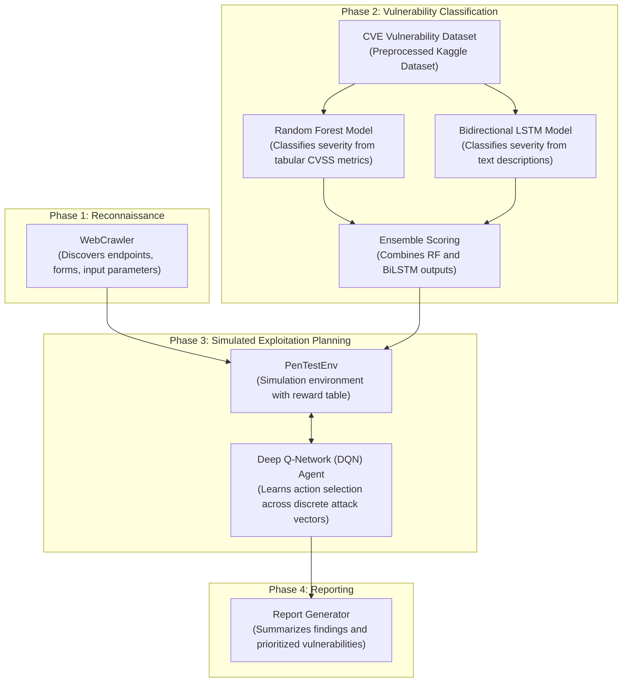

# Assignment 3: Proudest Project — Project Overview

**Candidate:** Ballapuram Prakash Royal  
**Project Title:** Intelligent Multi-Layer Penetration Testing System Using Hybrid AI Models (IMLPTS)  
**Research Reference:** [IEEE Xplore Digital Library — Document ID 11518386](https://ieeexplore.ieee.org/document/11518386)  
**Candidate GitHub:** [https://github.com/BallapuramPrakashRoyal](https://github.com/BallapuramPrakashRoyal)  
**Academic Context:** Department of Computer Science and Technology, Madanapalle Institute of Technology & Science (MITS)  
**Project Guide:** Dr. K. Dinesh, Manikandan R.  
**Co-Authors:** Prakash Royal B., Sai Kavya Sri Rebba, Sai Keerthana Chukka  

---

## 1. Project Overview & Problem Addressed

Traditional automated penetration testing tools typically rely on static vulnerability scanners and pre-configured signature files. While useful for finding known misconfigurations, they exhibit two common limitations:
1. They generate large volumes of raw alerts without evaluating how different vulnerabilities can be combined.
2. They lack adaptive decision-making to prioritize which attack vectors to test next based on target responses.

The **Intelligent Multi-Layer Penetration Testing System (IMLPTS)** was developed as an academic research project to explore how combining supervised classification models with reinforcement learning could help structure and automate the penetration testing workflow.

---

## 2. Technical Architecture & Workflow

The system is organized into a four-phase workflow:

1. **Phase 1 — Reconnaissance:** A web crawler discovers endpoints, forms, and input fields on the target application to map the accessible attack surface.
2. **Phase 2 — Vulnerability Classification:** 
   - A **Random Forest** classifier trained on tabular CVSS metrics predicts vulnerability severity levels.
   - A **Bidirectional LSTM** deep learning model trained on vulnerability text descriptions processes textual context.
   - Predictions are combined into an ensemble score to establish an initial risk assessment.
3. **Phase 3 — Exploitation Simulation (DQN):** 
   - A custom simulation environment (`PenTestEnv`) represents the testing state.
   - A **Deep Q-Network (DQN)** agent with an experience replay buffer selects tactical actions from a **discrete action space** (Reconnaissance, SQL Injection, XSS, CSRF, Remote Code Execution, Privilege Escalation).
   - The agent receives simulated feedback rewards based on whether chosen actions align with high-severity attack opportunities.
4. **Phase 4 — Reporting:** An automated report generator aggregates findings, tested vectors, and risk levels into a readable summary.

---

## 3. Technologies & Models Used

- **Programming Language:** Python 3.9+
- **Data Source:** Preprocessed Kaggle Common Vulnerabilities and Exposures (CVE) dataset.
- **Machine Learning (Scikit-learn):** Random Forest classifier (150 trees, maximum depth 10) evaluating tabular vulnerability attributes.
- **Deep Learning (TensorFlow / Keras):** Bidirectional LSTM with an embedding layer (10,000 token vocabulary, 128 embedding dimensions) and dropout regularization for text classification.
- **Reinforcement Learning:** Deep Q-Network (DQN) with a two-layer neural network approximation, experience replay memory (deque), and epsilon-greedy exploration over a discrete 6-action space.
- **Data Processing & Utilities:** NumPy, Pandas, Matplotlib, BeautifulSoup.

---

## 4. Candidate's Actual Engineering Contribution

Working as part of a team under the guidance of Dr. K. Dinesh:
1. Developed the Python implementation of the `PenTestEnv` simulation environment and the `DQNAgent` reinforcement learning loop, including the experience replay memory and action selection logic.
2. Implemented the basic `WebCrawler` to extract form fields and input names from target pages.
3. Assisted in preprocessing the CVE dataset (cleaning missing fields and formatting feature arrays for model training).
4. Co-authored the research paper detailing the methodology and experimental results, published in the IEEE Xplore Digital Library (Document ID: 11518386).

---

## 5. Engineering Challenges & Limitations

### Challenges Encountered
- **Model Coordination:** Connecting outputs from the supervised classification models (Random Forest and BiLSTM) to initialize the state representation for the reinforcement learning agent.
- **Data Preprocessing:** Cleaning and normalizing heterogeneous CVE records where text descriptions and tabular metrics often had inconsistent formatting.
- **Reinforcement Learning Convergence:** Tuning the reward table in `PenTestEnv` so that the DQN agent learned to prioritize high-risk actions without stalling in repetitive loops.

### Practical Limitations
- **Simulation Environment:** The DQN agent operates against a modeled simulation environment (`PenTestEnv`) rather than executing active zero-day exploit payloads against real infrastructure.
- **Scope of Target:** The crawler and environment were designed around web application form targets and do not generalize to low-level binary exploitation or complex distributed cloud architectures.
- **Fixed Action Space:** The discrete 6-action space is a high-level representation of penetration testing categories rather than a comprehensive library of attack payloads.
